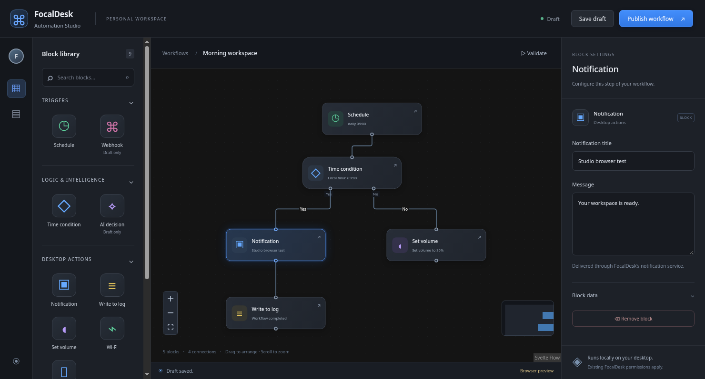

# FocalDesk Automation Studio

A Svelte Flow / Tauri desktop app for the existing FocalDesk Lua automation
engine. The interface follows the supplied three-pane wireframe: searchable
block library, dotted graph canvas, and contextual block settings.



## Run

```sh
npm ci --prefix apps/focaldesk-automation-studio/frontend
cargo run -p focaldesk-automation-studio
```

The Linux desktop requires the same GTK 3 and WebKitGTK 4.1 development packages
as FocalMail. Node.js 22.12+ is required at build time. Cargo embeds the built
frontend; installed apps need no Node or development server.

`just install-automation-studio` installs the app, launcher entry, and icon.
Install the updated daemon separately with `just install-automation-service`
(or `just install-automation-service-fedora` for the system-wide Fedora service).
The updated daemon is required to discover Studio manifests.

For browser UI development:

```sh
npm run dev --prefix apps/focaldesk-automation-studio/frontend
```

Browser mode saves drafts in localStorage and clearly identifies itself as a
preview. Validation and publishing require the native Rust bridge. Browser
drafts do not automatically transfer to native storage.

## Editing and publishing

- Drag blocks from the library, or click a library block to add it. Drag nodes to
  arrange them; drag from an output port to another block's input to connect.
- Select a block to edit its settings. Select nodes or edges and press Delete
  or Backspace to remove them. Pan, zoom, fit, and navigate with the minimap.
- Name the workflow, then **Save draft** (Ctrl/Cmd+S). The document icon in the
  left rail opens saved workflows and creates new ones. Changing workflows
  prompts before discarding unsaved edits.
- **Validate** checks the graph and previews generated Lua without executing it.
- **Publish workflow** validates and writes a scheduled automation. Publishing
  enables the schedule. Restart `focaldesk-automation.service` to activate the
  revision: `systemctl --user restart focaldesk-automation.service`.

Supported executable blocks: daily/interval schedule, a local-hour Yes/No
condition, notifications, journal logging, volume, Wi-Fi, and Bluetooth.
AI decision and webhook blocks preserve design intent in drafts but **block
publishing**: the current engine has no AI decision API or event trigger loop.
Email, HTTP, and database actions in the reference image are not engine APIs.

V1 graphs have exactly one schedule root, no cycles or merges, and no
unreachable blocks. Each action has at most one incoming connection. Multiple
outgoing actions run in connection order, sequentially; a Lua error stops the
run. Condition branches use the explicit Yes and No ports. There is no arbitrary
Lua or command-execution field in the visual editor. Existing daemon IPC
permission checks remain authoritative.

Native drafts live in `$XDG_CONFIG_HOME/focaldesk/automation/studio/drafts`.
Publishing creates an immutable Lua revision under `studio/scripts` and commits
its manifest atomically under `studio/published`. Hand-authored
`automations.toml` and scripts are preserved. Daemon names use `studio:<id>`;
display names live with the drafts. Old Lua revisions are retained.

To disable a published flow, set `enabled = false` in its
`studio/published/<id>.toml` manifest and restart the daemon. Publishing it again
enables it. Deleting or renaming a draft does not disable its published version.

## Verification

```sh
npm run check --prefix apps/focaldesk-automation-studio/frontend
npm test --prefix apps/focaldesk-automation-studio/frontend
cargo test -p focaldesk-automation --offline
cargo check -p focaldesk-automation-studio --offline
cargo clippy -p focaldesk-automation -p focaldesk-automation-studio --offline --all-targets -- -D warnings
```

Browser tests require Google Chrome (override with `CHROME_BIN`) and verify
node dragging, editing, deletion, draft save/reopen, and native-only publishing.
Compiler tests cover Lua escaping, graph validation, branching, unsupported
blocks, publication isolation, and daemon discovery. Delivery of notifications
and desktop controls requires a running FocalDesk session and is a manual
integration check.

[Svelte Flow documentation](https://svelteflow.dev/learn)
