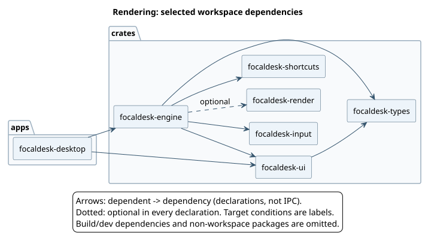

# FocalDesk UML

Start with the runtime overview, then use the dependency and sequence views
to inspect individual boundaries. Diagram sources are local PlantUML text;
the SVGs can be viewed in a browser without installing a UML editor.

| View | SVG | Editable source | Provenance |
| --- | --- | --- | --- |
| Runtime architecture | [Overview](system-overview.svg) | [PlantUML](system-overview.puml) | Curated process and interaction boundaries |
| Workspace dependencies | [Whole workspace](workspace-dependencies.svg) | [PlantUML](workspace-dependencies.puml) | Generated from Cargo metadata |
| Rendering components | [Focused dependencies](rendering-components.svg) | [PlantUML](rendering-components.puml) | Generated subset of workspace dependencies |
| Rendering lifecycle | [Commit to scanout](rendering-sequence.svg) | [PlantUML](rendering-sequence.puml) | Curated from the raw Vulkan DRM implementation |
| Desktop IPC | [Snapshot request](desktop-ipc-sequence.svg) | [PlantUML](desktop-ipc-sequence.puml) | Curated from client transport, socket worker, and compositor dispatch |
| Rendering types | [Selected types](rendering-types.svg) | [PlantUML](rendering-types.puml) | Curated fields, methods, ownership, and trait realization |



## Regenerate and check

From the repository root:

```sh
just uml-generate
just uml-check
```

Generation uses Python's standard library and
`cargo metadata --format-version 1 --no-deps --offline --locked`. It does not
compile Rust, fetch dependencies, or require a diagram renderer. Cargo must be
able to read all workspace manifests and referenced local path dependencies.

`uml-check` runs the generator's fixture tests and verifies that the generated
PlantUML and [dependency model](workspace-dependencies.json) match the current
manifests. It does not verify the semantics of manually maintained diagrams or
compare SVGs. When diagrams or manifests change, regenerate sources and SVGs
and review the affected runtime diagrams against their source anchors below.

## Render locally

Use an installed `plantuml` command, or supply a downloaded PlantUML JAR:

```sh
just uml-render
# Or, without a plantuml command on PATH:
PLANTUML_JAR=/path/to/plantuml.jar just uml-render
```

Equivalent direct invocation:

```sh
python3 scripts/generate-uml.py --render --plantuml-jar /path/to/plantuml.jar
```

The checked-in SVGs were rendered with **PlantUML 1.2025.10** and Java 25.
Use that PlantUML version for consistent layout. Java and the JAR are external
tools; the generator does not download or install them. The shared
[style](style.puml) selects Smetana, PlantUML's embedded layout engine, so an
external Graphviz installation is unnecessary. Rendering stays local and
does not submit source code to a diagram server. Renderer errors fail the
command, and each output is checked as SVG XML.

Upstream references: [Cargo metadata](https://doc.rust-lang.org/cargo/commands/cargo-metadata.html),
[PlantUML command line](https://plantuml.com/command-line),
[Smetana layout](https://plantuml.com/smetana02), and
[PlantUML 1.2025.10](https://github.com/plantuml/plantuml/releases/tag/v1.2025.10).

## What the generated dependency diagrams mean

- Nodes are workspace packages grouped by manifest directory (`apps`,
  `crates`, or `services`). These are code dependencies, not running processes.
- Arrows point from the dependent package to its dependency.
- Only normal dependencies between workspace packages are shown. Build and
  development dependencies and external packages, including Smithay and
  external VUI path dependencies, are excluded.
- Optional dependencies appear even when disabled in a particular build;
  dotted arrows indicate dependencies optional in every declaration. Labels
  retain platform conditions and dependency aliases. This is a declared graph,
  not a feature-resolved or target-resolved build graph.
- The focused rendering diagram shows only edges between the selected
  rendering/input/UI packages. It is intentionally not their full dependency
  closure. The JSON model retains individual declarations; the diagrams
  consolidate multiple declarations for each package pair.

The generator uses Cargo's structured metadata rather than searching Rust
text for imports. Runtime IPC, dynamic dispatch, callbacks, macro expansions,
and exact call ordering require a separately reviewed view.

## Source anchors for curated diagrams

These views are implementation summaries, not automatically extracted call
graphs. Search for the symbols below when updating them; line numbers change.

| Diagram | Sources and anchors |
| --- | --- |
| Runtime overview | [Architecture guide](../architecture.md); [desktop backend selection](../../apps/focaldesk-desktop/src/main.rs); [engine backends](../../crates/focaldesk-engine/src/backend); [MCP mail bridge](../../services/focaldesk-mcp/src/mail.rs) |
| Rendering sequence | [Wayland hooks](../../crates/focaldesk-engine/src/core/wayland/compositor.rs): `new_surface`, `commit`; [raw DRM loop](../../crates/focaldesk-engine/src/backend/drm_vulkan.rs): `run`, `expand_dmabuf_damage`, `KmsFence`, `DrmEvent::VBlank`; [raw renderer](../../crates/focaldesk-render/src/ash_drm.rs): `render`, `poll`, `compile_shader` |
| Desktop IPC sequence | [CLI](../../apps/focaldesk-cli/src/main.rs): `desktop-snapshot`; [client](../../crates/focaldesk-ipc/src/lib.rs): `send_desktop_request`; [transport](../../crates/focaldesk-ipc/src/transport.rs): `DESKTOP_POLICY`, `read_limited`, `decode_message`; [desktop state](../../crates/focaldesk-engine/src/core/desktop.rs): `handle_desktop_settings_ipc_stream`, `process_settings_ipc_requests`, `handle_settings_ipc_request`, `desktop_snapshot`; [service pump](../../crates/focaldesk-engine/src/backend/common.rs): `pump_desktop_services` |
| Rendering types | [Raw DRM types](../../crates/focaldesk-engine/src/backend/drm_vulkan.rs): `VulkanDrmData`, `VulkanOutput`, `KmsFence`; [renderer types](../../crates/focaldesk-render/src/ash_drm.rs): `AshDrmRenderer`, `PendingFrame`, `ImportedTarget`, `LinearScene`, `AshDrmSubmission`; [retention](../../crates/focaldesk-render/src/lib.rs): `FrameRetention` |

The rendering sequence distinguishes GPU completion (client-buffer and GPU
resource retirement) from KMS vblank (scanout-buffer retirement). It also
shows the NVIDIA bounded-wait path separately from explicit KMS input fences.
The type diagram uses composition only for directly owned state and an
association for shared retention handles; Rust traits are shown as interfaces.
